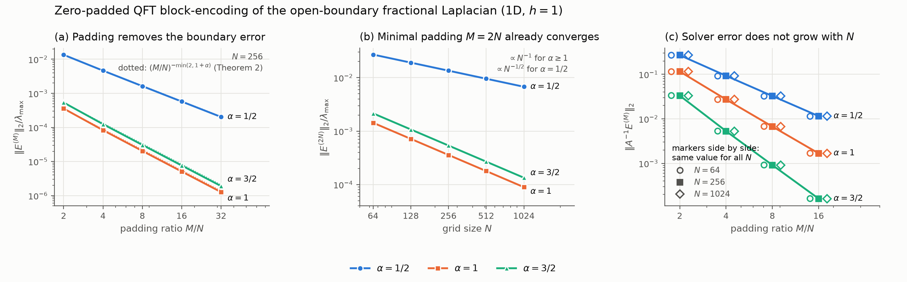

# Boundary-aware QFT block-encoding of fractional Laplacians: code

A quantum Fourier transform (QFT) applies the fractional Laplacian with a simple,
closed-form symbol |ξ|^α, but only with periodic boundary conditions. On a bounded
domain with zero exterior data the target is instead a Toeplitz matrix. We show
that zero-padding the register from N to M points, applying the same QFT symbol
oracle, and compressing back recovers this open-boundary operator up to an
explicitly bounded error. In d dimensions that error is
C(N/M² + N^d/M^(d+α)) on the block-encoding scale, so already at the minimal
size M = 2N it decays as N^(-min(1,α)). Compared with an exact circulant
embedding, whose eigenvalues must be precomputed and loaded from a table of
(2N)^d entries (16 GiB for a 1024³ grid), the padded construction keeps an
analytic oracle at essentially the same normalization and, for α ≥ 1, the same
register size.

Scripts that reproduce the numerical results of

> Y. Javanmard and S. Kazemian, *Boundary-Aware QFT Block-Encoding of Fractional
> Laplacians*, arXiv:2605.16749.

*(a) The boundary error of the zero-padded QFT block falls with the padding ratio at the
rate predicted by Theorem 2. (b) Already at minimal padding M = 2N it decays as 1/N for
α ≥ 1 and as N^(-1/2) for α = 1/2. (c) The error relevant for inverting the operator does
not grow with the grid size N at fixed M/N. Reproduce with `python make_summary_figure.py`.*

All computations are classical linear algebra in double precision (Python 3.10+,
see `requirements.txt`). Install with `pip install -r requirements.txt`.

| Script | Reproduces | Typical run |
|---|---|---|
| `make_figures.py` | Figs. 4–8 (heatmaps, functional benchmarks, padding decay, Gaussian diagnostics, boundary sweep) | `python make_figures.py --figure all --outdir figs` |
| `padding_1d_quadrature_verified.py` | Table III: 1D residual at M = 2N and register size m for ε = 1e-2, 1e-3, 1e-4 | `python padding_1d_quadrature_verified.py --outdir results` (`--quick` for a short run) |
| `solver_and_normalization.py` | Table IV: inversion perturbation ‖A⁻¹E‖₂; normalization ratio Γ/λ_max of the exact 2N circulant (Sec. IV.A) | `python solver_and_normalization.py` |
| `verify_3d.py` | Table V: 3D residuals with two reference grids | `python verify_3d.py --mode quick --output results/3d.csv` |
| `make_summary_figure.py` | Summary figure above (`summary.png`) | `python make_summary_figure.py` |
| `test_comparator_lcu.py` | Appendix F: exact comparator/LCU block-encoding of the 1D α = 1 symbol | `python test_comparator_lcu.py` |

## Notes

* The 1D Toeplitz coefficients c_r are computed by adaptive quadrature; the padded
  operator independently by an M-point FFT of the sampled symbol.
* The 3D target kernel is computed on a finite reference Fourier grid Q³; the
  script reports the change between two reference grids. These values are
  numerical support, not certified bounds. The quick mode needs a few GB of RAM.
* Gate and qubit counts in Sec. IV.A are analytic model estimates and are not
  produced by these scripts.
* Some scripts were written with the assistance of AI language models; all
  reported values were checked by independent implementations or closed-form
  results (see the Acknowledgments of the paper).
